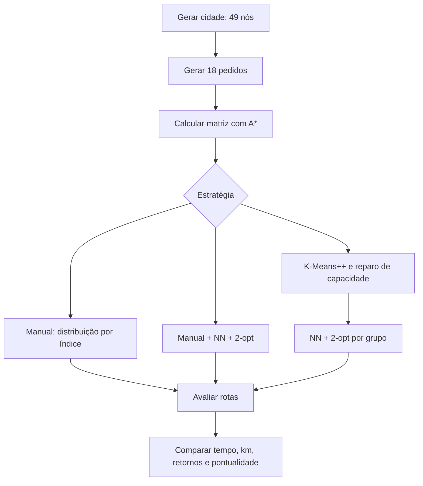

# 🚚 SABOR EXPRESS — Rota Inteligente

**Otimização de entregas com algoritmos de Inteligência Artificial**

**Autor:** Henrique Ribeiro Siqueira  
**Instituição:** UniFECAF  
**Curso:** Ciência da Computação — 6º semestre  
**Disciplina:** Fundamentos de Inteligência Artificial  
**Data do projeto:** 02/11/2026


## 1. Descrição do problema

O restaurante fictício **Sabor Express** precisa distribuir pedidos por diferentes regiões de uma cidade. Rotas montadas manualmente podem gerar deslocamentos desnecessários, atrasos e desequilíbrio entre entregadores. A malha urbana inclui restrições reais de circulação, como vias de mão única, uma rua interditada e um rio atravessável somente por duas pontes.

**Desafio:** planejar a distribuição e a ordem de atendimento de **18 pedidos** entre **3 entregadores**, com **até 6 pedidos por entregador**, minimizando o tempo de deslocamento e avaliando o cumprimento de um prazo de **60 minutos** para chegada ao cliente.

### Objetivos

- Modelar a cidade como um **grafo dirigido e ponderado**.
- Encontrar caminhos de menor tempo entre loja e clientes com **A\***.
- Agrupar clientes geograficamente com **K-Means++**, respeitando a capacidade por meio de reparo posterior.
- Ordenar as visitas usando **vizinho mais próximo (NN)** e refinar cada rota com **2-opt**.
- Comparar três estratégias de planejamento por métricas reproduzíveis.


## 2. Cenário e parâmetros

| Parâmetro | Valor no código |
|---|---|
| Malha urbana | Grade 7 × 7, total de **49 nós** (IDs 0 a 48) |
| Coordenadas | `XY[7*y+x] = (0.5*x, 0.5*y)` em km |
| Loja | Nó **24**, centro da grade |
| Pedidos | **18** nós distintos da loja, amostrados com semente 42 |
| Entregadores / grupos | `K = 3` |
| Capacidade por entregador | `CAP = 6` pedidos |
| Tempo de serviço | `SERVICO = 2` minutos por entrega |
| Prazo de chegada | `PRAZO = 60` minutos |
| Velocidade de referência | `VMAX = 40` km/h |
| Distância por rua | **0,5 km** |
| Aleatoriedade da cidade | Semente fixa `2026` |
| Inicialização do agrupamento | Semente fixa `42`, 10 tentativas |

> **Observação:** todos os dados são simulados. O modelo não usa GPS, mapas reais, previsão de trânsito ou pedidos de um restaurante real.


## 3. Abordagem adotada


### 3.1. Construção da cidade — `cidade()`

A função cria um dicionário de adjacência: cada nó representa um cruzamento e cada aresta representa um trecho de rua. As arestas guardam `(destino, minutos, quilômetros)`. O código considera quatro direções ortogonais, respeitando os limites da grade.

Restrições implementadas:

1. **Rio:** as ligações horizontais entre as colunas 3 e 4 são removidas, exceto nas linhas 1 e 5 (duas pontes).
2. **Mão única:** na linha 2, deslocamentos para a esquerda são proibidos; na linha 4, deslocamentos para a direita são proibidos.
3. **Interdição:** a ligação vertical entre os nós **17 e 24** é removida nos dois sentidos.
4. **Congestionamento simulado:** trechos no interior da região de coordenadas de grade `1 ≤ x ≤ 5` e `1 ≤ y ≤ 5` recebem fator `1.65`; os demais recebem `1.1`. Cada aresta também recebe fator pseudoaleatório entre `1` e `1.45`.

O tempo de uma aresta é calculado por:

```text
tempo_min = (60 × 0,5 / 40) × fator_regional × fator_aleatorio
```

O comprimento de cada trecho permanece em **0,5 km**, independentemente do tempo de viagem.


### 3.2. Menores caminhos — `astar(grafo, origem, destino)`

O **A\*** encontra o caminho com menor **tempo estimado de viagem** entre dois nós. Utiliza uma fila de prioridade (`heapq`), os melhores custos conhecidos e predecessores para reconstruir o trajeto.

A heurística é a distância euclidiana em linha reta dividida pela velocidade de referência:

```text
h(n) = 60 × distancia_euclidiana(XY[n], XY[destino]) / VMAX
```

Como cada trecho tem tempo não inferior ao tempo de percorrê-lo a 40 km/h, essa heurística é **admissível**; assim, o A\* encontra o menor tempo no grafo modelado. A função devolve `(tempo_min, distancia_km, caminho)` e gera erro se o destino for inalcançável.

Uma **matriz de custos** é pré-calculada para os 19 terminais (loja + 18 pedidos). Cada par ordenado recebe sua própria consulta A\*, pois a rede é **dirigida** e, portanto, o tempo de `A → B` pode ser diferente de `B → A`.


### 3.3. Agrupamento — `agrupar(pedidos)`

O código implementa uma versão de **K-Means com inicialização K-Means++**:

1. Sorteia o primeiro centro e escolhe os seguintes proporcionalmente ao quadrado da distância ao centro mais próximo.
2. Atribui cada pedido ao centro euclidiano mais próximo.
3. Recalcula os centroides; trata grupos vazios transferindo pontos de grupos com mais de um elemento.
4. Repete até estabilizar as atribuições ou atingir 100 iterações.
5. Executa 10 inicializações e seleciona a de menor **SSE** (*soma dos quadrados das distâncias aos centroides*).
6. **Repara a capacidade**: enquanto algum grupo tiver mais de 6 pedidos, transfere pedidos para grupos com vagas, escolhendo a transferência de menor aumento da SSE.

**Importante:** o agrupamento considera **distância euclidiana**, não os tempos reais do grafo. O reparo de capacidade é uma etapa adicional: o K-Means isolado não garante grupos de mesmo tamanho.

### 3.4. Ordenação das entregas — `otimizar(grupo, pedidos, matriz)`

**Vizinho mais próximo (NN):** parte da loja e seleciona repetidamente o pedido ainda não visitado com menor tempo de deslocamento desde o ponto atual.

**2-opt:** avalia inversões de segmentos da sequência de entregas. Para cada candidata, recalcula o **custo completo da rota**, incluindo a volta à loja e respeitando os sentidos das ruas. Aceita a melhor melhoria e repete até não haver redução adicional de tempo.

A otimização é **heurística**, portanto não garante a melhor rota global. O tempo de serviço é constante por entrega e não altera a comparação entre permutações do mesmo grupo.


## 4. Algoritmos utilizados

| Algoritmo / técnica | Função no projeto | Característica |
|---|---|---|
| **A\*** | Menor caminho entre terminais | Busca informada por heurística admissível |
| **K-Means++ / K-Means** | Formação de 3 grupos geográficos | Clustering com múltiplas inicializações |
| **Reparo por SSE** | Respeitar limite de 6 pedidos | Realocação gulosa entre grupos |
| **Nearest Neighbor (NN)** | Construção da ordem inicial de visitas | Heurística gulosa |
| **2-opt** | Melhoria da ordem das visitas | Busca local por reversão de segmentos |

**BFS e DFS não são usados nesta implementação.** Eles são algoritmos possíveis de travessia de grafos, mas não substituem diretamente o A\* para minimizar tempos em uma rede com pesos diferentes.


## 5. Diagramas do modelo


### 5.1. Fluxo da solução




### 5.2. Esquema da grade e travessias

O esquema abaixo mostra os **IDs dos nós** da grade. As arestas reais são criadas pela função `cidade()` e têm restrições de direção e interdição descritas acima.

```text
 y=0    00 — 01 — 02 — 03   ║   04 — 05 — 06
 y=1    07 — 08 — 09 — 10 — P — 11 — 12 — 13
 y=2    14 — 15 — 16 — 17   ║   18 — 19 — 20
 y=3    21 — 22 — 23 — 24   ║   25 — 26 — 27
 y=4    28 — 29 — 30 — 31   ║   32 — 33 — 34
 y=5    35 — 36 — 37 — 38 — P — 39 — 40 — 41
 y=6    42 — 43 — 44 — 45   ║   46 — 47 — 48

║ = rio (sem passagem horizontal)
P = ponte nas linhas 1 e 5
Loja = nó 24
```

> Diagrama **conceitual**, não mapa de adjacência completo: as conexões verticais, sentidos únicos e pesos estão definidos no código. O marcador `P` indica a travessia entre as colunas 3 e 4 e não é um nó adicional.


## 6. Estratégias comparadas

| Estratégia | Distribuição | Ordenação |
|---|---|---|
| **Manual** | Índices `0,3,6...`, `1,4,7...`, `2,5,8...` | Ordem original dos pedidos |
| **NN + 2-opt** | Mesmos grupos da estratégia manual | NN seguido de 2-opt |
| **K-Means + NN + 2-opt** | K-Means++ com reparo de capacidade | NN seguido de 2-opt |

As três estratégias são avaliadas sobre **a mesma cidade e os mesmos 18 pedidos**, permitindo comparação justa dentro da simulação.


## 7. Métricas e análise dos resultados

A função `avaliar()` valida se cada pedido aparece exatamente uma vez e se nenhum grupo excede a capacidade. Em seguida, calcula:

| Métrica | Interpretação | Direção desejada |
|---|---|---|
| `viagem (min)` | Soma dos tempos de deslocamento de todos os entregadores, inclusive retornos | Menor |
| `km` | Soma das distâncias percorridas por todos os entregadores | Menor |
| `último retorno` | Maior duração individual entre os entregadores, incluindo serviço e retorno à loja | Menor |
| `entrega média` | Média dos instantes de chegada aos 18 clientes, contados a partir de zero para cada entregador | Menor |
| `pontualidade` | Percentual de pedidos cuja chegada ocorre até 60 minutos | Maior |

A duração de cada entregador soma **deslocamento + 2 minutos de serviço por pedido + retorno**. Já a chegada de cada cliente é registrada **antes** dos seus 2 minutos de serviço.

### Como interpretar os resultados

Execute o script para obter os **valores numéricos reais da simulação**. O programa imprime uma linha por estratégia e a sequência de pedidos de cada entregador (`P01`, `P02` etc.). Não há valores fixos inventados neste README.

Em geral, é esperado que **NN + 2-opt** não aumente o tempo de viagem dos grupos manuais, pois o 2-opt só aceita melhorias e a rota inicial do NN pode ser diferente da manual. **Não é garantido** que NN + 2-opt supere a estratégia manual em toda instância: NN pode começar com uma ordem pior e o 2-opt pode parar em um ótimo local. O **K-Means + NN + 2-opt** também não tem garantia de superar os outros métodos, porque o agrupamento otimiza proximidade geométrica, não diretamente o tempo de rota no grafo.


## 8. Eficiência computacional

- **A\*:** depende da quantidade de nós e arestas; com fila de prioridade, uma busca tem custo típico da ordem de `O((V + E) log V)` sob hipóteses usuais. Nesta grade há `V = 49` e um número limitado de arestas.
- **Matriz:** são executadas `19 × 19 = 361` consultas A\*, incluindo os pares de origem e destino iguais. Esse pré-cálculo evita buscas repetidas durante a otimização.
- **K-Means:** com `n = 18`, `K = 3`, 10 inicializações e até 100 iterações por inicialização, o custo é pequeno para a simulação. O reparo de capacidade avalia mudanças de SSE.
- **NN:** faz escolhas sucessivas entre pedidos restantes, com custo aproximado de `O(m²)` para um grupo de `m` pedidos.
- **2-opt:** testa `O(m²)` reversões por rodada; como o custo de cada rota é recalculado em `O(m)`, a implementação tem custo `O(m³)` por rodada. O número de rodadas depende das melhorias encontradas.

Como cada entregador atende no máximo **6 pedidos**, a busca local é viável neste cenário. **Não foram medidos tempo de CPU ou consumo de memória**, portanto não se atribuem números de desempenho computacional sem teste.


## 9. Limitações

1. **Cidade artificial:** a grade não representa uma rede viária real.
2. **Trânsito estático:** os tempos das arestas são sorteados uma vez e não variam durante a entrega.
3. **Pedidos sem demanda variável:** todos ocupam uma unidade de capacidade; não há peso ou volume.
4. **K-Means geométrico:** os agrupamentos não consideram mão única, pontes ou congestionamento.
5. **Capacidade rígida:** o reparo depende da existência de vagas; a implementação foi dimensionada para 18 pedidos e capacidade total de 18.
6. **Prazo apenas avaliado:** os 60 minutos não são impostos como restrição durante a otimização.
7. **Heurísticas sem ótimo global garantido:** NN e 2-opt podem parar em soluções subótimas.
8. **Sem custo monetário:** combustível, salários e emissões não entram na função objetivo.
9. **Sem visualização cartográfica interativa:** a versão fornecida é executada pelo terminal.


## 10. Sugestões de melhoria

- Usar **OpenStreetMap/OSMnx** para obter ruas reais e limites de velocidade.
- Substituir o agrupamento euclidiano por **agrupamento baseado em tempos de viagem**.
- Aplicar algoritmos para **CVRP/VRPTW** (roteamento de veículos com capacidade e janelas de tempo), como OR-Tools, com restrições explícitas de prazo.
- Considerar **trânsito dinâmico**, pedidos novos, disponibilidade de entregadores e replanejamento.
- Experimentar **simulated annealing, busca tabu, algoritmos genéticos** ou otimização exata para comparação.
- Criar interface **Streamlit**, mapa interativo e gráficos das métricas.
- Executar **múltiplas sementes e cenários** para calcular médias, dispersão e robustez das melhorias.
- Medir tempo de processamento e memória, além de distância, pontualidade e tempo de viagem.


## 11. Como executar

**Requisito:** Python 3.8 ou superior. O código utiliza somente a biblioteca padrão (`heapq`, `math`, `random`, `statistics`), sem dependências externas.

1. Salve o código fornecido como `sabor_express.py`.
2. Abra um terminal na pasta do arquivo.
3. Execute:

```bash
python sabor_express.py
```

No Windows, caso o comando `python` não esteja disponível, tente `py sabor_express.py`.

**Saída esperada (estrutura, não valores simulados):**

```text
Método | viagem(min) | km | último retorno | entrega média | pontualidade
Manual | ... | ... | ... | ... | ...
  E1: loja -> P... -> loja
  E2: loja -> P... -> loja
  E3: loja -> P... -> loja
NN + 2-opt | ...
  ...
K-Means + NN + 2-opt | ...
  ...
```

Os geradores com sementes fixas tornam os resultados reproduzíveis em condições equivalentes de execução.


## 12. Conclusão

O projeto integra **representação por grafos, busca heurística, clustering e otimização combinatória** em um problema de logística urbana. O A\* calcula caminhos que respeitam as restrições da cidade; o K-Means++ organiza os pedidos por proximidade, com ajuste de capacidade; e NN + 2-opt determina sequências de visita e procura reduzir o tempo total de viagem. A comparação com uma distribuição manual permite avaliar empiricamente os benefícios e as limitações de cada estratégia, sem presumir que a combinação mais complexa seja sempre a melhor.

---
